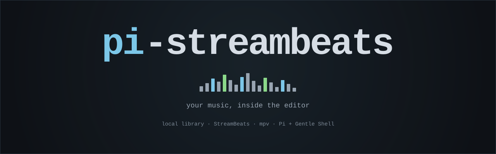

# pi-streambeats

<div align="center">

<a href="https://github.com/egkike/pi-streambeats">
  
</a>

<a href="https://github.com/Gentleman-Programming/gentle-ai">
  
</a>

</div>

Your music, inside the editor: a card for [Pi](https://pi.dev) and Gentle Shell that browses a local
music library and plays it with [mpv](https://mpv.io), without taking the keyboard away from you.

> **Status: early development.** Nothing is published yet — `pi install` would fail, and this
> repository holds the toolchain, the CI and the specification, not the product. The specification is
> [`odd/tasks/sb-music-card.md`](odd/tasks/sb-music-card.md): 19 numbered specs quoted from the owner's
> own words, plus the log of every decision behind them.

## What it is

`/sb-music` opens a card. It is a slash command, **never an agent tool**: your library and your listening
history never reach the model's context.

- **A card, not a window.** It lives in the corner of the terminal and shows what is playing without
  covering your work. `l` expands it into a list, `esc` hides it, and the status bar keeps the
  now-playing line either way.
- **The keyboard stays yours.** The card is not modal: once you pick a track it releases input back to
  the editor, so you keep typing while the music plays.
- **Two sources.** Your own folders (v1) and the free [StreamBeats](https://streambeats.bandcamp.com/music)
  catalog (later slice). Local files are read, never touched.
- **mpv plays.** The card drives a real `mpv` process over its JSON IPC socket, so playback survives the
  card being hidden and the audio is not tied to the terminal's redraw loop.

## What it will not do

- **It will never write inside your music folder.** No sync, no renames, no downloads: the only files it
  creates are its own `settings.json` and a socket.
- **No accounts, no cookies, no telemetry.** There is nothing to log into.
- **No system theme.** Colours come from the host's theme, so the card belongs to your terminal instead
  of fighting it.

## Requirements

| Requirement | Why |
| --- | --- |
| Pi or Gentle Shell | The card is an extension of the host's TUI; it has no UI of its own |
| [mpv](https://mpv.io) 0.41+ | Playback. Without it the card still browses and says so |
| Node 22.19+ | The host's floor, declared in `engines` and exercised in CI |

## Development

```sh
pnpm install
pnpm check          # lint + typecheck + tests
node scripts/ipc-probe.mjs mpv   # the real transport, against a real mpv
```

`pnpm check` never spawns mpv and never reads your library: the tests fake both. The transport is proven
separately by the probe, which is what CI runs on macOS against a Homebrew mpv.

CI runs on Ubuntu 26.04 with Node 22.19 and 24 — the declared floor is a promise only if something
executes it — plus macOS 26 for the darwin code path and the real IPC probe. Windows is validated on a
Windows 11 VM (toolchain, gate and named-pipe transport) and joins CI with task T12.

## Design

The card and this banner were designed before being implemented, as artboards:

- [`design/sb-music-card/`](design/sb-music-card/) — the corner card (default state) and the expanded
  list, with the ASCII fallback for terminals that render geometric glyphs double-width.
- [`design/pi-streambeats-banner/`](design/pi-streambeats-banner/) — this banner, chosen from three
  directions.

## Contributing

The project is single-owner: changes travel through an issue-linked pull request and the owner merges.
Bug reports and feature requests are the useful contribution — open an issue. Security problems go
through the private advisory form, never a public issue.

## License

MIT — see [LICENSE](LICENSE).
