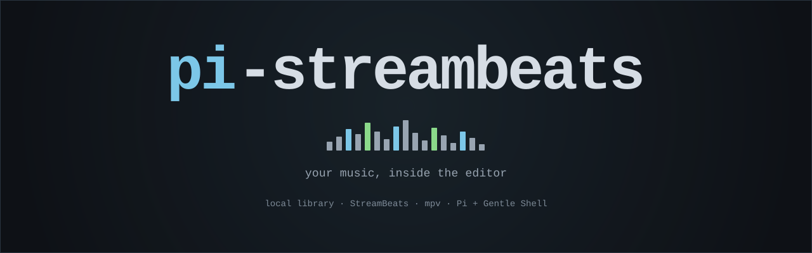

# pi-streambeats

<div align="center">

<a href="https://github.com/egkike/pi-streambeats">
  
</a>

<a href="https://github.com/Gentleman-Programming/gentle-ai">
  
</a>

</div>

Your music, inside the editor: a card for [Pi](https://pi.dev) and Gentle Shell that browses a local
music library and plays it with [mpv](https://mpv.io), without taking the keyboard away from you.

> **Status: early development.** The first release is out and the card installs from git — see
> [Install](#install). Nothing is on npm: a git tag is the pin. The card is usable, not finished, and the
> specification is [`odd/tasks/sb-music-card.md`](odd/tasks/sb-music-card.md): 20 numbered specs quoted from
> the owner's own words, plus the log of every decision behind them.

## Install

With **Pi**:

```sh
pi install git:github.com/egkike/pi-streambeats          # the tip of main
pi install git:github.com/egkike/pi-streambeats@v0.1.1   # a release, pinned
```

With **Gentle Shell**, the same command with `gentle-shell` in front of it — the Shell recognises the Pi
subcommand and runs it in its own agent home, which it keeps separate by default (`~/.gentle-shell/agent`,
with its own `settings.json`). A plain `pi install` would land in the vanilla Pi home and the card would not
appear in the Shell:

```sh
gentle-shell install git:github.com/egkike/pi-streambeats@v0.1.1
```

Gentle Shell parses its own options first (`--link`, `--isolated`, `--home`) and hands the subcommand to Pi,
so `install`, `remove` and `list` read exactly as they do under `pi`.

If you run Gentle Shell with `--link`, it shares your Pi home instead of its own (`gentle-shell home` prints
the mode in effect), and the plain `pi install` covers both.

**To remove it.** The same source string you installed, with `remove` (or `uninstall`):

```sh
pi remove git:github.com/egkike/pi-streambeats@v0.1.1              # Pi
pi uninstall git:github.com/egkike/pi-streambeats@v0.1.1          # the same command
gentle-shell remove git:github.com/egkike/pi-streambeats@v0.1.1   # Gentle Shell
```

`pi list` (or `gentle-shell list`) prints the exact source strings that are configured, which is the string
`remove` expects. Removing the package never touches your music library, and it leaves the card's own two
paths behind — they are yours, not the package's:

| | Linux | macOS | Windows |
| --- | --- | --- | --- |
| `settings.json` | `~/.config/pi-streambeats/` | `~/.config/pi-streambeats/` | `%APPDATA%\pi-streambeats\` |
| catalog metadata | `~/.cache/pi-streambeats/catalog.json` | `~/Library/Caches/pi-streambeats/catalog.json` | `%LOCALAPPDATA%\pi-streambeats\catalog.json` |

Delete those two if you want the configuration and the cache gone as well. The only other path the card
creates is the mpv socket — `$XDG_RUNTIME_DIR/pi-streambeats/mpv.sock` on Linux when that variable is set,
otherwise inside the cache directory, and `~/Library/Caches/pi-streambeats/` on macOS; Windows uses a named
pipe, which is not a file. Any of them is safe to delete while the card is not playing.

The tag is the pin, and it is exact: `@v0.1.1` installs the commit whose `package.json` says `0.1.1`, and
no other. The `Release tag` workflow fails when a pushed tag does not match that version, so a pin cannot
quietly point at different code. Without a tag you get the tip of `main` — the next release while it is
being built.

**What it needs.**

| Requirement | Why |
| --- | --- |
| Pi or Gentle Shell | The card is an extension of the host's TUI; it has no UI of its own |
| Node 22.19 or newer | The host's floor, declared in `engines` |
| [mpv](https://mpv.io) | Playback. `mpv` on `PATH` is the normal case; without it the card still browses and says so |

**Where it runs.** This is what was verified, not a support promise:

| Platform | What was verified |
| --- | --- |
| Linux | The suite runs here: `pnpm check` on Ubuntu 26.04 with Node 22.19, 24 and 26 |
| macOS | The real mpv transport: the `ipc` job runs the probe on a macOS runner against Homebrew mpv. The suite itself runs on Ubuntu, and the darwin code path is covered there because the platform-dependent functions take `platform` as a parameter |
| Windows | Windows 11 with mpv 0.42.0, on a VM, where the card itself was used: installed from the tag, opened, browsed the library and played a file with mpv found outside `PATH`. The whole suite runs there too — 573 tests, 0 failures — and the tests Windows cannot run skip with the reason the OS gives: POSIX permission bits and `chmod`, control characters in file names, and a socket directory a named pipe does not have. There is no Windows job in CI |

**If mpv is not on `PATH`.** The Windows installer (`winget install shinchiro.mpv`) leaves mpv in
`C:\Program Files\MPV Player` and does not touch `PATH`. The card looks for mpv in one order: `mpvPath` in
`settings.json`, then `PATH`, then the few locations each platform's installer really uses
(`C:\Program Files\MPV Player\mpv.exe` on Windows, the two Homebrew prefixes on macOS, `/usr/bin` and
`/usr/local/bin` on Linux). The first candidate has to answer `--version`, so a configured binary that does
not run is reported instead of silently skipped.

Setting the path is one key in `%APPDATA%\pi-streambeats\settings.json` on Windows
(`~/.config/pi-streambeats/settings.json` elsewhere):

```json
{ "mpvPath": "C:\\Program Files\\MPV Player\\mpv.exe" }
```

The value has to be absolute, or a bare command name that `PATH` resolves: a relative path like `bin/mpv`
is refused, because the same settings file would otherwise point at a different binary depending on where
Pi was started.

## What it is

`/sb-music` opens a card. It is a slash command, **never an agent tool**: your library and your listening
history never reach the model's context.

- **A card, not a window.** It lives in the corner of the terminal and shows what is playing without
  covering your work. One key — `ctrl+alt+z` by default — cycles it hidden → corner → expanded → hidden,
  `esc` hides it, and the status bar keeps the now-playing line either way. See [Keys](#keys).
- **The keyboard stays yours.** The card is not modal: it takes the keyboard only while it is expanded
  and focused, and `esc` hands it straight back to the editor, so nothing is trapped behind a window.
- **Two sources.** Your own folders and the free [StreamBeats](https://streambeats.bandcamp.com/music)
  catalog, in the same card. It opens in the catalog; `l` swaps to your library, and `l` again brings you
  back to the album you were on. Local files are read, never touched. See [The catalog](#the-catalog).
- **mpv plays.** The card drives a real `mpv` process over its JSON IPC socket, so playback survives the
  card being hidden and the audio is not tied to the terminal's redraw loop.

## Keys

Every key below exists; there is no separate expand key, because the cycle key owns both sizes. To see
the table with the values your machine is actually using, run `/sb-music --keys`.

**From the editor.** Registered when the session starts, and they work with the card open, hidden, or
never opened at all:

| Key | What it does |
| --- | --- |
| `ctrl+alt+z` | Cycle the card: hidden → corner → expanded → hidden |
| `ctrl+alt+space` | Pause or resume |
| `ctrl+alt+n` | Next track |
| `ctrl+alt+p` | Previous track |

On macOS the terminal's `alt` is <kbd>⌥</kbd>, so `ctrl+alt+z` is <kbd>ctrl</kbd>+<kbd>⌥</kbd>+<kbd>z</kbd>.
Some terminals need “Option as Meta” enabled before <kbd>⌥</kbd> reaches the app as `alt`.

**Inside the card**, which owns the keyboard while it is expanded and focused:

| Key | What it does |
| --- | --- |
| `↑` `↓`, `k` `j` | Move the cursor |
| `enter` | Open the folder or play the track |
| `space` | Pause or resume |
| `n` `>`, `p` `<` | Next, previous |
| `u`, `⌫` | Up one folder, or out of an album |
| `l` | Switch source: catalog ↔ your library |
| `/` | Filter the current folder |
| `s` | Stop and empty the queue |
| `+` `-` | Volume |
| `z` | Shuffle the rest of the queue |
| `esc` | Hide the card (clears the filter first) |

## The catalog

The catalog is a second source of the same listing, not a second screen. It opens by default; `l` moves
between it and your own folders, and each one remembers where you left it.

- **Its index is a cache, and the cache is the point.** Metadata lands in
  `$XDG_CACHE_HOME/pi-streambeats/catalog.json` (mode `0600`, written atomically), never inside your music
  folder and never carrying an audio URL. A warm cache opens the card with **no network at all**.
- **It revalidates itself.** After a day the next open re-reads the catalog **in the background**: the list
  you see stays, the cursor stays on the album you were browsing, and a failed refresh says one short line
  instead of throwing the list away.
- **Progress is honest.** The footer says `reading catalog…` while the index is on its way — the total is not
  known before that — and then `reading catalog · 3 of 12 albums`, counting albums that arrived *or* were
  skipped as missing, so the count always reaches the end instead of sticking halfway.
- **No cache and no network is not an error screen.** The card falls back to your library and says
  `catalog unavailable · reopen to retry`. Reopening the card retries; nothing is silently empty.
- **Playing costs one request.** A signed audio URL is resolved immediately before each play and never
  stored: a cached URL is an expired URL. Nothing is downloaded — the catalog is streamed through `mpv`.

## Changing the keys

```sh
/sb-music --keys                                    # what is in effect, and where the file is
/sb-music --keys overlay=ctrl+alt+m                 # change one key
/sb-music --keys overlay=ctrl+alt+m next=alt+ctrl+k # several at once, all or nothing
/sb-music --keys overlay=default                    # back to the documented default
/sb-music --help                                    # the syntax, plus the table
```

A value needs a modifier (`ctrl`, `alt` or `shift`) — a bare `j` would take that key away from the editor
— and the value has to be a key Pi itself can produce. No two of the four keys may be the same, and the
name has to be one of `overlay`, `playPause`, `next`, `prev`. Anything else is refused with a message, and
nothing is written.

They are saved in `~/.config/pi-streambeats/settings.json`
(`$XDG_CONFIG_HOME/pi-streambeats/settings.json`; `%APPDATA%\pi-streambeats\settings.json` on Windows),
under `shortcuts`. **A change applies at the next session**: Pi binds shortcuts when the session starts,
so the session you edited from keeps the key it was bound with — and `--keys` shows the new value from the
file next to it.

## What it will not do

- **It will never write inside your music folder.** No sync, no renames, no downloads: the only files it
  creates are its own `settings.json`, its metadata cache and a socket.
- **No accounts, no cookies, no telemetry.** There is nothing to log into.
- **No system theme.** Colours come from the host's theme, so the card belongs to your terminal instead
  of fighting it.

## Limits worth knowing

These are properties of the terminal or of the host, not bugs waiting to be fixed:

| Limit | Why |
| --- | --- |
| The hover highlight can stay on the last row the pointer touched | The host reports motion and clicks, but never that the pointer *left* the card |
| Hover degrades inside tmux or zellij | Those multiplexers do not forward mouse motion the way a fullscreen TUI expects |
| Clicking the corner card does nothing | It is a passive readout with no rows; navigation happens in the expanded card |
| `ctrl+c` with the card focused closes the card instead of interrupting Pi | The host's component interface returns nothing for a key, so the card cannot forward it. Closing the card gives the keyboard back, and the next `ctrl+c` reaches Pi |

## Requirements

| Requirement | Why |
| --- | --- |
| Pi or Gentle Shell | The card is an extension of the host's TUI; it has no UI of its own |
| [mpv](https://mpv.io) 0.41+ | Playback. Without it the card still browses and says so |
| Node 22.19+ | The host's floor, declared in `engines` and exercised in CI |

## Development

```sh
pnpm install
pnpm check          # lint + typecheck + tests
node scripts/ipc-probe.mjs mpv   # the real transport, against a real mpv
```

`pnpm check` never spawns mpv and never reads your library: the tests fake both. The transport is proven
separately by the probe, which is what CI runs on macOS against a Homebrew mpv.

CI runs the suite on Ubuntu 26.04 with Node 22.19, 24 and 26 — the declared floor is a promise only if
something executes it. **macOS does not run the suite**: the macOS runner pool serves roughly one job per
run, so asking for two starved whichever lost the race and turned `gate` red on infrastructure instead of
on code. macOS runs the real IPC probe, against Homebrew mpv, when a change touches the transport; the
darwin code path itself stays covered on Ubuntu because the platform-dependent functions are pure and take
`platform` as a parameter. A darwin-only path owes a test that runs from Linux, or its own job. Windows is
validated on a Windows 11 VM — the whole suite, and the named-pipe transport — and has no CI job of its own.

## Design

The card and this banner were designed before being implemented, as artboards:

- [`design/sb-music-card/`](design/sb-music-card/) — the corner card (default state) and the expanded
  list, with the ASCII fallback for terminals that render geometric glyphs double-width.
- [`design/pi-streambeats-banner/`](design/pi-streambeats-banner/) — this banner, chosen from three
  directions.

## Contributing

The project is single-owner: changes travel through an issue-linked pull request and the owner merges.
Bug reports and feature requests are the useful contribution — open an issue. Security problems go
through the private advisory form, never a public issue.

## License

MIT — see [LICENSE](LICENSE).
